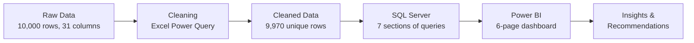

# Credit Card Fraud Detection Analysis

An end-to-end BFSI fraud analytics project: a raw (synthetic) credit card transaction dataset is cleaned in **Excel Power Query**, analysed with **SQL Server**, and presented in a 6-page interactive **Power BI** dashboard.

> **Note:** All data is synthetic. It does not represent any real bank, customer or card. All monetary values are in INR.

---

## Table of Contents
1. [Project Overview](#1-project-overview)
2. [Business Problem](#2-business-problem)
3. [Project Objectives](#3-project-objectives)
4. [Tools & Technologies](#4-tools--technologies)
5. [Dataset Information](#5-dataset-information)
6. [Data Cleaning](#6-data-cleaning)
7. [SQL Analysis](#7-sql-analysis)
8. [Power BI Dashboard](#8-power-bi-dashboard)
9. [Key Insights & Recommendations](#9-key-insights--recommendations)
10. [Project Workflow](#10-project-workflow)
11. [Repository Structure](#11-repository-structure)
12. [How to Reproduce](#12-how-to-reproduce)

---

## 1. Project Overview

This project looks at card transactions from a bank's fraud-risk point of view. It covers **how much fraud there is, where and when it happens, how well the alert system catches it, how much money is lost or recovered through chargebacks, and which customer behaviours look suspicious**.

The work follows the process a bank data analyst would use: clean a messy raw extract, answer business questions with SQL, and turn the results into a dashboard that fraud and risk teams can filter and explore.

## 2. Business Problem

A bank loses money and customer trust when fraudulent transactions get through, but too many false alerts annoy genuine customers and waste investigators' time. The fraud-risk team needs clear answers to questions such as:

- How many transactions are confirmed fraud, and how much money is involved?
- Which channels, merchant categories, locations and times of day carry the highest fraud risk?
- How good is the alert system: how many alerts are real fraud, how many are false positives, and how much fraud is missed?
- How much fraud money is actually lost, how much is prevented by declines, and how much is recovered through chargebacks?
- Which customers and behaviours (unusual frequency, high value, IP mismatch) deserve closer monitoring?

## 3. Project Objectives

- Clean the raw dataset and document every cleaning decision.
- Calculate transaction, fraud, fraud-monitoring, chargeback and customer-behaviour KPIs.
- Find the channels, merchants, geographies and time windows linked to higher fraud.
- Measure alert quality (false positive rate, alert-to-fraud conversion, fraud detection rate).
- Quantify fraud loss, prevented fraud and chargeback recovery.
- Build an interactive Power BI dashboard with synced slicers.
- Turn the findings into practical fraud-prevention recommendations.

## 4. Tools & Technologies

| Tool | Used for |
|---|---|
| **Microsoft Excel (Power Query)** | Data cleaning and standardisation (Advanced Editor / M code) |
| **SQL Server (SSMS)** | Table design (primary key, data types), KPI and business-question queries (T-SQL) |
| **Power BI Desktop** | Data modelling, DAX measures, calculated columns, 6-page interactive dashboard |
| **Git / GitHub** | Version control and project hosting |

## 5. Dataset Information

| Item | Details |
|---|---|
| Raw records | **10,000** transactions (includes 30 duplicate rows) |
| Unique transactions | **9,970** |
| Columns | **31** |
| Customers | 650 |
| Data type | Synthetic (no real customers, no real card numbers) |
| Currency | INR |
| Date range | 01-May-2026 to 31-Oct-2026 (6 months) |
| Channels | Online, POS, ATM |
| Transaction status | Approved, Declined |
| Confirmed fraud | 150 transactions (about 1.5%), generated from seven fraud scenarios |

**Column groups:** transaction information (ID, date/time, card token, customer, account, amount), merchant information (ID, category, country, city), channel and device (channel, card present, entry mode, terminal, device), location and risk (IP country, billing country, domestic/international flag, status, response code), spending behaviour (30-day average, 1-hour and 24-hour counts, time since last transaction, distance from previous transaction) and fraud and investigation (high-risk merchant flag, alert flag, confirmed fraud flag, chargeback status, investigation outcome).

About 3.2% of the raw rows (320 rows) contain intentionally injected data-quality issues. See [`SOURCE DATA/data_dictionary.csv`](Credit%20Card%20Fraud%20Detection%20Analysis/SOURCE%20DATA/data_dictionary.csv), [`SOURCE DATA/data_quality_issue_summary.md`](Credit%20Card%20Fraud%20Detection%20Analysis/SOURCE%20DATA/data_quality_issue_summary.md), [`SOURCE DATA/methodology.md`](Credit%20Card%20Fraud%20Detection%20Analysis/SOURCE%20DATA/methodology.md) and [`SOURCE DATA/fraud_label_logic.md`](Credit%20Card%20Fraud%20Detection%20Analysis/SOURCE%20DATA/fraud_label_logic.md).

## 6. Data Cleaning

Cleaning was done in **Excel Power Query**. The whole process is in one M script, with every correction kept as a named step.

**Record flow:** 10,000 raw rows → 30 exact duplicates removed (by `Transaction_ID`) → **9,970 rows used for analysis**. No confirmed-fraud row was removed.

| Issue type | How it was handled |
|---|---|
| **Duplicate records** | Removed by `Transaction_ID` (30 rows). |
| **Date/time errors** (2-digit year, DD/MM/YYYY, missing time, impossible dates) | Corrupted `Transaction_DateTime` values restored by `Transaction_ID`; column set to datetime type. |
| **Invalid amounts** (negative, zero, non-numeric, outliers above 200,000) | Corrected by `Transaction_ID`; amount set to a numeric type. |
| **Incorrect data types** | Text-formatted amounts, distances and 24-hour counts converted to proper numbers. |
| **Inconsistent labels** | `Transaction_Channel` standardised to Online / POS / ATM; country names standardised (for example India, Singapore); `Transaction_Status` standardised to Approved / Declined. |
| **Status conflicting with response code** | 8 transactions whose status contradicted the authorization response code were corrected. |
| **Wrong `Card_Present_Flag`** | 15 values corrected. |
| **Missing values** | `Customer_Avg_Amount_30D`, `Device_ID`, `IP_Country`, `Merchant_City`, `Merchant_ID` and `Terminal_ID` filled where a value should exist. |
| **Structural blanks** | Blanks that are correct by design (no `Terminal_ID` for Online, no `Device_ID` / `IP_Country` for POS/ATM) were set to `No`. |

Files: [`Excel/Full Project Completed.txt`](Credit%20Card%20Fraud%20Detection%20Analysis/Cleaning%20Started/Excel/Full%20Project%20Completed.txt) (Power Query M code) and [`Excel/credit_card_transactions_synthetic.csv`](Credit%20Card%20Fraud%20Detection%20Analysis/Cleaning%20Started/Excel/credit_card_transactions_synthetic.csv) (cleaned output, 9,970 rows).

## 7. SQL Analysis

The 9,970 cleaned rows were loaded into SQL Server (database `CCFDA`, table `cc`, primary key on `Transaction_ID`, amounts as `DECIMAL(18,2)`, `Card_Present_Flag` as `BIT`). The analysis script is organised in **7 sections**:

| Section | Business questions |
|---|---|
| **1. Transaction analysis** | Total transactions, total and average amount, approved / declined, approval rate |
| **2. Fraud analysis** | Confirmed fraud, fraud rate, fraud amount, fraud loss, fraud by channel, merchant category, domestic vs international, amount group, time of day and spending behaviour |
| **3. Fraud monitoring** | Total alerts, confirmed fraud alerts, false positives, false positive rate, alert-to-fraud conversion, fraud detection rate |
| **4. Chargeback analysis** | Chargebacks filed, chargeback amount, chargeback success rate, chargeback status |
| **5. Customer behaviour** | Customers with multiple alerts, unusual frequency, high-value transactions, IP vs billing country, merchant country, spending vs fraud |
| **6. Fraud patterns** | Card entry mode, suspicious signals, merchant risk, channel risk, monthly alert trend, false positives by channel, investigation outcomes |
| **7. Financial loss prevention** | Where the fraud money went (lost, prevented, recovered, in progress) and missed fraud |

**Key definitions**

- **Fraud rate** = Confirmed fraud transactions / all transactions.
- **Fraud loss** = Amount of confirmed fraud that was **Approved** and whose chargeback is **Lost** or **Not Applicable** (money that actually left the customer's account and is not recovered).
- **Fraud prevented** = Amount of confirmed fraud attempts that were **Declined**.
- **Fraud recovered** = Confirmed fraud with chargeback **Won**; **in progress** = chargeback **Filed** or **Pending**.
- **False positive** = `Alert_Flag = Yes` and `Confirmed_Fraud_Flag = No`. **False positive rate** = false positives / all legitimate transactions.
- **Alert-to-fraud conversion** = Confirmed fraud alerts / total alerts. **Fraud detection rate** = Confirmed fraud alerts / confirmed fraud transactions.
- **Chargeback success rate** = Won / (Won + Lost).

> The dataset's `methodology.md` suggests a simpler fraud-loss assumption (approved fraud minus chargebacks Won). This project uses the stricter definition above, so Filed and Pending chargebacks are shown separately as "recovery in progress" instead of being counted as loss.

**Headline KPIs**

| KPI | Value |
|---|---|
| Total transactions | 9,970 |
| Total transaction amount | ₹5,39,47,967.52 |
| Average transaction amount | ₹5,411.03 |
| Approved / Declined | 9,605 / 365 |
| **Approval rate** | **96.34%** |
| Confirmed fraud transactions | 150 |
| **Fraud rate** | **1.50%** |
| Fraud amount (all confirmed fraud) | ₹12,46,545.21 |
| Average fraud amount | ₹8,310.30 |
| **Fraud loss** | **₹5,62,561.03** |
| Fraud prevented (declined) | ₹4,37,384.54 |
| Fraud recovered (chargeback won) | ₹1,78,267.49 |
| Fraud recovery in progress | ₹68,332.15 |
| Total alerts | 445 |
| Confirmed fraud alerts | 72 |
| False positives | 373 |
| **False positive rate** | **3.80%** (83.82% of all alerts are false positives) |
| Alert-to-fraud conversion | 16.18% |
| **Fraud detection rate** | **48.00%** |
| Missed fraud (no alert) | 78 transactions, ₹6,23,786.41 |
| Chargebacks filed | 106 (₹5,10,116.06) |
| **Chargeback success rate** | **40.85%** (29 won, 42 lost) |

Files: [`SQL/CREATE Tables And Insert Query.sql`](Credit%20Card%20Fraud%20Detection%20Analysis/Cleaning%20Started/SQL/CREATE%20Tables%20And%20Insert%20Query.sql) (create table + 9,970 inserts), [`SQL/All Answers .sql`](Credit%20Card%20Fraud%20Detection%20Analysis/Cleaning%20Started/SQL/All%20Answers%20.sql) (all queries) and [`SQL/credit_card_transactions_synthetic.csv`](Credit%20Card%20Fraud%20Detection%20Analysis/Cleaning%20Started/SQL/credit_card_transactions_synthetic.csv) (final analysis data).

## 8. Power BI Dashboard

A 6-page dashboard with slicers for **Month, Transaction Channel and Transaction Geography** (plus Merchant Category on page 1). It uses calculated columns (amount group, time of day, spending group, IP check) and DAX measures for every KPI. All measures are in [`PowerBI/DAX ALL CORRECTED.txt`](Credit%20Card%20Fraud%20Detection%20Analysis/Cleaning%20Started/PowerBI/DAX%20ALL%20CORRECTED.txt).

**Page 1: Executive Overview**


**Page 2: Transaction Analysis**


**Page 3: Fraud Analysis**


**Page 4: Fraud Monitoring**


**Page 5: Chargeback and Loss**


**Page 6: Customer Behaviour**


Files: [`PowerBI/credit card fraud detection analysis.pbix`](Credit%20Card%20Fraud%20Detection%20Analysis/Cleaning%20Started/PowerBI/credit%20card%20fraud%20detection%20analysis.pbix) and [`PowerBI/completed.pdf`](Credit%20Card%20Fraud%20Detection%20Analysis/Cleaning%20Started/PowerBI/completed.pdf) (PDF export of all pages).

## 9. Key Insights & Recommendations

### Key insights

- **Overall:** 150 of 9,970 transactions (**1.50%**) are confirmed fraud, worth ₹12.47 lakh. Of this, ₹5.63 lakh was actually lost, ₹4.37 lakh was stopped by declines, ₹1.78 lakh was recovered through chargebacks and ₹0.68 lakh is still in recovery.
- **Online is the riskiest channel.** Fraud rate: Online **2.49%**, ATM 1.71%, POS 0.73%. Online carries 98 of the 150 fraud cases.
- **International transactions are far riskier.** International fraud rate **19.83%** (69 of 348) against 0.84% for domestic.
- **Some merchant categories stand out.** Gift Cards **10.81%**, Money Transfer 8.77%, Gaming 6.14%, Jewellery 3.47%, E-commerce 2.78%. Transactions at high-risk-flagged merchants have an 8.65% fraud rate against 1.10% at other merchants.
- **Night time is the danger window.** Fraud rate at night (00:00-06:00) is **8.21%**, against 0.66% in the morning, 1.45% in the afternoon and 1.56% in the evening.
- **Mid-sized amounts are the sweet spot for fraud.** The 10K-50K group has the highest fraud rate (3.74%), while 50K+ is only 0.82%.
- **Spending above the customer's norm raises risk.** Fraud rate rises from 1.09% (below average) to 1.85% (1x-2x), 2.53% (2x-5x) and 2.15% (5x+).
- **IP mismatch is a strong signal.** Online transactions where the IP country differs from the billing country have a 47.33% fraud rate (71 fraud cases among 150 such transactions).
- **The alert system is noisy and misses fraud.** 445 alerts raised, but only 72 are real fraud (16.18% conversion); 373 are false positives. Detection rate is 48.00%, so **78 fraud transactions (₹6.24 lakh) had no alert**.
- **Chargeback recovery is modest.** 106 chargebacks filed (₹5.10 lakh); success rate is 40.85% (29 won, 42 lost).
- **Customers:** 101 of 650 customers have 2 or more alerts, and 78 transactions show unusual frequency (3+ transactions in 1 hour or 5+ in 24 hours).

### Recommendations

1. **Add step-up authentication for international online transactions** (OTP / 3-D Secure / device check), since this segment has the highest fraud rate.
2. **Apply stricter rules to Gift Cards, Money Transfer and Gaming merchants,** such as lower limits and extra verification.
3. **Tighten monitoring at night (00:00-06:00),** for example lower velocity thresholds and real-time review of large or foreign transactions.
4. **Use IP-country mismatch, new device and spending above 2x the 30-day average as combined risk signals** in the alert rules instead of single thresholds.
5. **Reduce false positives without losing detection.** Review the alert rules that fire on legitimate travel and large purchases, so that investigators can focus on the 16% of alerts that are real fraud.
6. **Close the detection gap.** Study the 78 missed fraud cases (low-value online fraud, own-device and home-area skimming) and add rules for those patterns.
7. **Improve chargeback handling.** Review why 42 disputes were lost and speed up evidence collection for Filed and Pending cases.

### Limitations

- The data is synthetic, so the percentages show analytical patterns, not real bank performance.
- Fraud was generated from seven fixed scenarios, so some patterns (for example night-time fraud or IP mismatch) are partly a result of how the data was built.
- Injected errors were corrected using the original values supplied with the synthetic dataset. On real data these fixes would need business rules or confirmation from the source system.
- Fraud loss is based on a stated assumption (see key definitions) because the dataset has no recovery or loss column.
- The dataset covers 6 months and 650 customers; fraud is rare (1.5%), so small segments should be read carefully.

## 10. Project Workflow



**Raw Data → Cleaning → SQL → Power BI → Insights**

## 11. Repository Structure

```
Credit-Card-Fraud-Detection-Analysis/
├── README.md
└── Credit Card Fraud Detection Analysis/
    ├── SOURCE DATA/
    │   ├── credit_card_transactions_synthetic.csv            (raw data, 10,000 rows)
    │   ├── credit_card_transactions_clean_reference.csv      (untouched generated data)
    │   ├── data_dictionary.csv
    │   ├── data_quality_issue_log.csv
    │   ├── data_quality_issue_summary.md
    │   ├── methodology.md
    │   ├── fraud_label_logic.md
    │   ├── generate_cc_fraud_dataset.py                      (dataset generator)
    │   ├── Credit Card Fraud Detection Details.txt
    │   ├── Business Analysis Requirements.txt
    │   └── Objective.txt
    ├── Cleaning Started/
    │   ├── Excel/
    │   │   ├── Full Project Completed.txt                    (Power Query cleaning code)
    │   │   └── credit_card_transactions_synthetic.csv        (cleaned, 9,970 rows)
    │   ├── SQL/
    │   │   ├── CREATE Tables And Insert Query.sql            (create table + inserts)
    │   │   ├── All Answers .sql                              (analysis queries)
    │   │   └── credit_card_transactions_synthetic.csv        (final analysis data)
    │   └── PowerBI/
    │       ├── credit card fraud detection analysis.pbix
    │       ├── DAX ALL CORRECTED.txt                         (all DAX measures)
    │       └── completed.pdf
    └── Screenshots/
        ├── 01_Executive_Overview.jpg
        ├── 02_Transaction_Analysis.jpg
        ├── 03_Fraud_Analysis.jpg
        ├── 04_Fraud_Monitoring.jpg
        ├── 05_Chargeback_and_Loss.jpg
        └── 06_Customer_Behaviour.jpg
```

## 12. How to Reproduce

1. **Clone the project:** `git clone https://github.com/sahil-bfsi-analytics/Credit-Card-Fraud-Detection-Analysis.git`
2. **Clean the data:** load `Credit Card Fraud Detection Analysis/SOURCE DATA/credit_card_transactions_synthetic.csv` into an Excel table named `Table1` and run the Power Query code from `Credit Card Fraud Detection Analysis/Cleaning Started/Excel/Full Project Completed.txt`.
3. **SQL Server:** create a database named `CCFDA`, run `Credit Card Fraud Detection Analysis/Cleaning Started/SQL/CREATE Tables And Insert Query.sql` to create the `cc` table and insert the 9,970 rows, then run `Credit Card Fraud Detection Analysis/Cleaning Started/SQL/All Answers .sql`.
4. **Power BI:** open `Credit Card Fraud Detection Analysis/Cleaning Started/PowerBI/credit card fraud detection analysis.pbix`. If the data source path asks for an update, point it to the final analysis data in `Credit Card Fraud Detection Analysis/Cleaning Started/SQL/credit_card_transactions_synthetic.csv` (Transform data → Data source settings). The measures are listed in `DAX ALL CORRECTED.txt`.
